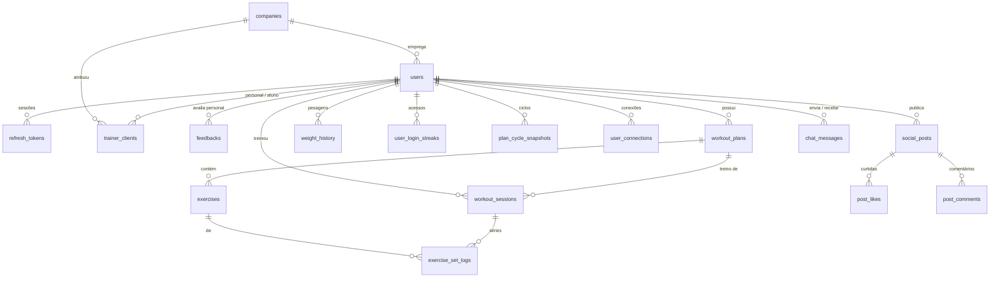

# Banco de dados do Kinetic

Referência de como o schema está organizado, por que cada tabela existe e quais
regras o banco garante sozinho. Complementa o diagrama do Supabase — aqui está o
raciocínio que o diagrama não mostra.

## Fundamentos

**PostgreSQL hospedado no Supabase.** O Supabase é usado como *host* de Postgres
e como Storage de mídia. Nada mais: não há Supabase Auth, não há PostgREST no
caminho, nenhum cliente fala direto com o banco.

**O backend é a única porta de entrada.** O `kinetic-backend` (Spring Boot)
conecta via JDBC pelo pooler, como role `postgres`. App mobile e painel web só
enxergam a API REST. Toda autorização vive em Java — papéis, vínculos e
visibilidade de feed são decididos lá, não por policies de banco.

**Migrations versionadas com Flyway** em
[`db/migration/`](../kinetic-backend/src/main/resources/db/migration/). O
Hibernate roda com `ddl-auto=validate`: ele confere se as entidades batem com o
schema, mas nunca altera nada. Quem muda estrutura é migration, sempre.

**RLS habilitado em todas as tabelas, sem policy nenhuma.** Isso é intencional
(`V21`): o Supabase publicaria o schema `public` na API PostgREST, e RLS deny-all
fecha essa porta. O backend não é afetado porque `postgres` é dono das tabelas e
tem `BYPASSRLS`. O linter do Supabase reclama "RLS Enabled No Policy" — é ruído
esperado, não pendência. Toda tabela nova precisa repetir isso na própria
migration; RLS não é herdado.

## Mapa geral



`users` é o hub: praticamente toda tabela referencia ela. Quase todas as FKs para
usuário usam `ON DELETE CASCADE` — apagar a conta leva junto treinos, posts,
mensagens e vínculos.

## Identidade e papéis

### `users`

Tabela central. Mistura três coisas que valem ser lidas separadamente:

- **Credenciais**: `email` (único), `senha` (hash BCrypt), `cpf` (único).
- **Perfil de treino**, preenchido no onboarding: `birth_date`, `height`,
  `weight`, `goal`, `level`, `frequency`, `medical_conditions`. Alimentam a
  geração de ficha pela IA. `workout_onboarding_completed` marca se o fluxo
  terminou — é o que decide se o app abre a Home ou o onboarding.
- **Estado operacional**: `role`, `status`, `company_id`, `last_active`,
  `active_session_id`, `avatar_url`.

`role` (`VARCHAR(16)`, default `'ALUNO'`) assume os valores de
[`Role`](../kinetic-backend/src/main/java/com/kinetic/enums/Role.java): **ALUNO**,
**PERSONAL**, **EMPRESA**, **ROOT**. Todo usuário existente virou ALUNO pelo
DEFAULT quando a coluna nasceu, então o backfill foi automático. PERSONAL nasce
por auto-cadastro ou criado por uma EMPRESA; EMPRESA é criada pelo ROOT; ROOT é
semeado no boot.

`status` (default `'ATIVO'`) é compliance, aplicado pelo painel ROOT: **ATIVO**,
**SUSPENSO**, **BLOQUEADO**. Só ATIVO permite login — é barrado tanto na
autenticação quanto no filtro JWT, o que mata tokens já emitidos em vez de
esperar expirarem.

`last_active` + `active_session_id` juntos derivam presença em tempo real: com
sessão ativa e batimento recente → `TRAINING`; só batimento recente → `ONLINE`;
senão `OFFLINE`. Não existe coluna de presença — é sempre calculada na leitura.

### `companies`

`nome`, `cnpj` (único). Uma empresa agrupa personais (`users.company_id`) e pode
atribuir alunos a eles.

### `refresh_tokens`

`token_hash` (único), `expiry_date`, `user_id`. Guarda **hash**, não o token —
vazamento da tabela não permite falsificar sessão. Sustenta a rotação de refresh
token do app.

## Vínculo profissional

### `trainer_clients`

Liga personal a aluno. É onde mora a lógica de negócio mais interessante do
schema.

`source` distingue como o vínculo nasceu: **INVITE** (personal convida, nasce
`PENDENTE`, depende do aceite do aluno) ou **COMPANY** (empresa atribui, nasce
`ATIVO` direto, sem convite). `status` percorre **PENDENTE → ATIVO → ENCERRADO**,
ou **RECUSADO**.

Duas defesas ficam no banco, não só na aplicação:

```sql
CREATE UNIQUE INDEX uq_trainer_clients_one_active_per_student
    ON trainer_clients (student_id) WHERE status = 'ATIVO';
```

Índice único **parcial**: um aluno só pode ter um personal ativo. Vale só para
linhas `ATIVO`, então o histórico de vínculos encerrados convive sem conflito. É
a última linha de defesa contra corrida — dois aceites simultâneos que passaram
pela validação da aplicação antes do commit não passam ambos aqui.

O mesmo padrão evita convites pendentes duplicados
(`uq_trainer_clients_pending_pair`), e `chk_no_self_link` impede alguém virar
personal de si mesmo.

### `feedbacks`

Aluno avalia um personal, visível para a empresa. Carrega os três lados
(`student_id`, `personal_id`, `company_id`) e um flag `anonymous` que esconde o
autor na exibição. A elegibilidade (o vínculo precisa ter vindo da empresa) é
checada na aplicação; o banco só garante integridade referencial e leitura
eficiente por empresa.

## Treino

### `workout_plans` e `exercises`

Uma ficha (`workout_plans`) tem N `exercises`. O plano guarda metadados de
apresentação (`title`, `subtitle`, `tag`, `level`, `estimated_duration_minutes`).

`status` é `'active'` ou `'archived'`, com CHECK constraint. **Regenerar um plano
arquiva o anterior em vez de apagar** — o histórico e as métricas de evolução
dependem disso. Um índice parcial em `(user_id, status) WHERE status = 'active'`
faz a busca do plano vigente ser barata mesmo com muitos ciclos acumulados.

`exercises.section` (`AQUECIMENTO | PRINCIPAL | FINALIZACAO`) é classificada pela
IA na geração. É nullable: exercícios gerados antes dessa feature ficam NULL e o
app os agrupa como "Treino principal".

Note que `reps`, `weight` e `rest_time` são `varchar`, não numéricos — a IA
devolve coisas como `"8-12"` ou `"até a falha"`, que não cabem em `int`.

## Execução e métricas

Existem **duas granularidades de registro**:

| Tabela | Granularidade | Responde |
|---|---|---|
| `workout_sessions` | Treino concluído | "quanto tempo treinou, quando e qual ficha?" |
| `exercise_set_logs` | Série individual | "quanto peso levantou naquele exercício?" |

`exercise_set_logs` é a mais fina: `set_number`, `reps_performed`, `weight_used`,
amarrada a um `exercise_id` e a um `session_id`. É dela que sai o volume total
(carga × reps) e a progressão por músculo.

A ficha da sessão (`workout_plan_id`) é a dos exercícios registrados; treino que
mistura fichas fica sem ficha. A V53 trouxe isso e o `created_at` para a sessão e
apagou `workout_execution_logs`, que só repetia a sessão com a ficha.

### `plan_cycle_snapshots`

Fotografia de um ciclo encerrado, capturada no momento em que o plano é
regenerado: `total_volume`, `completed_sessions`, `target_sessions`,
`adherence_percentage`, `end_weight`, `volume_by_muscle`.

É **desnormalização deliberada**. Todos esses números poderiam ser recalculados
varrendo `exercise_set_logs`, mas o ciclo já acabou e o resultado nunca mais muda
— recomputar a cada abertura da tela de evolução seria desperdício. `volume_by_muscle`
é `TEXT` guardando JSON, o que evita uma tabela filha para um dado que só é lido
inteiro.

### `weight_history` e `user_login_streaks`

`weight_history` registra pesagens ao longo do tempo (`weight`, `logged_at`).

`user_login_streaks` alimenta o streak de dias consecutivos. A regra está no
banco: `UNIQUE (user_id, login_date)` torna impossível contar o mesmo dia duas
vezes, independentemente de quantas vezes o app chamar o endpoint.

## Social

### `user_connections`

Amizade entre usuários — **simétrica**, e é isso que a diferencia de
`trainer_clients`. `status` é `PENDING` ou `ACCEPTED`.

O truque está no índice de unicidade:

```sql
CREATE UNIQUE INDEX uq_connection_pair ON user_connections (
    LEAST(requester_id::text, addressee_id::text),
    GREATEST(requester_id::text, addressee_id::text)
);
```

Canonicaliza o par ordenando os dois ids. Sem isso, A→B e B→A seriam linhas
distintas e você teria conexões duplicadas em direções opostas. Com isso, a
segunda tentativa esbarra na constraint independentemente de quem convidou quem.

`requester_in_squad` / `addressee_in_squad` são dois booleanos separados porque
"squad" é uma marcação **unilateral**: eu posso destacar você no meu squad sem
que você me destaque no seu. Guardar um único flag perderia essa assimetria.

### `social_posts`

Uma tabela para duas coisas, discriminadas por `kind`: **POST** (permanente) e
**STORY** (expira). O que separa é `expires_at`, preenchido com 24h na criação da
story e nulo no post.

Um índice parcial atende a leitura de stories ativas sem pesar sobre os posts:

```sql
CREATE INDEX idx_social_posts_active_stories
    ON social_posts (author_id, expires_at, created_at) WHERE kind = 'STORY';
```

`workout_session_id` liga o post ao treino que o originou, com
`ON DELETE SET NULL` — apagar a sessão não apaga o post, só desfaz o vínculo.

**`image_url` não guarda URL.** Apesar do nome, o conteúdo é a *storage key* do
Supabase (ex.: `posts/<uuid>.jpg`). O bucket é privado; o backend gera uma URL
assinada de curta duração a cada leitura do feed, depois de já ter filtrado os
posts por conexão aceita. O nome da coluna ficou por compatibilidade — vale ter
isso em mente ao ler queries.

### `post_likes` e `post_comments`

Tabelas de junção convencionais. Contagens são agregadas por query, não mantidas
como contador desnormalizado em `social_posts`.

## Chat

### `chat_messages`

Mensagens diretas personal↔aluno. `read_at` nulo significa não lida.

Dois índices refletem as duas únicas consultas que existem:

- **Histórico da conversa** — usa o mesmo truque `LEAST`/`GREATEST` de
  `user_connections` para achar o par em qualquer direção com um único índice.
- **Contador de não-lidas** — índice parcial `WHERE read_at IS NULL`. Como a
  grande maioria das mensagens acaba lida, o índice fica pequeno e o badge de
  não-lidas sai barato.

## Infra

### `flyway_schema_history`

Controle do Flyway: qual migration rodou, quando, checksum e sucesso. Não mexer
manualmente. Foi a única tabela deixada de fora do `ENABLE ROW LEVEL SECURITY` da
`V21`, porque o Flyway mantém lock nela durante a execução e um `ALTER TABLE` ali
travaria a própria migration.

Produção já tem o histórico do Flyway, então o `application.properties` não configura
baseline: um banco sem `flyway_schema_history` é recusado na hora. Só os testes usam
`baseline-on-migrate` (na V49, a versão do snapshot), em `application-test.properties`.

## Convenções e inconsistências

**PKs são UUID** com `gen_random_uuid()`, gerados pelo banco. Ids não sequenciais
evitam enumeração via API.

**CHECK constraints contra auto-referência** aparecem em três tabelas
(`chk_no_self_connection`, `chk_no_self_link`, `chk_no_self_message`). Barato de
garantir no banco, chato de descobrir em produção.

**Índices parciais são o padrão da casa** — aparecem em planos ativos, stories,
vínculos ativos, mensagens não lidas. Sempre pelo mesmo motivo: a consulta quente
olha só um subconjunto pequeno da tabela.

Dois pontos fora do padrão, que valem conhecer antes de tropeçar:

- **`weight_history.id` é `int8` com IDENTITY**, não UUID. É a única tabela
  assim.
- **Mistura de `timestamp` e `timestamptz`.** `users.created_at`,
  `user_login_streaks.created_at` e as colunas de `refresh_tokens` usam
  `timestamptz`; o resto usa `timestamp` sem timezone. Enquanto tudo rodar no
  mesmo fuso não aparece problema, mas é a origem clássica de bug de uma hora ao
  internacionalizar ou ao mudar o TZ do servidor.

## Como evoluir o schema

1. Crie `V<n>__descricao.sql` em
   [`db/migration/`](../kinetic-backend/src/main/resources/db/migration/),
   com `n` maior que a última.
2. Se a migration cria tabela, **inclua RLS na mesma migration**:
   ```sql
   ALTER TABLE public.<t> ENABLE ROW LEVEL SECURITY;
   REVOKE ALL ON public.<t> FROM anon, authenticated;
   ```
   Nunca use `FORCE ROW LEVEL SECURITY` — o backend é dono das tabelas e cairia.
3. Atualize a entidade JPA correspondente. `ddl-auto=validate` derruba o boot se
   entidade e schema divergirem, o que é a rede de proteção contra esquecer isso.
4. Migration já aplicada não se edita — o Flyway valida checksum e falha. Corrija
   com uma migration nova.
